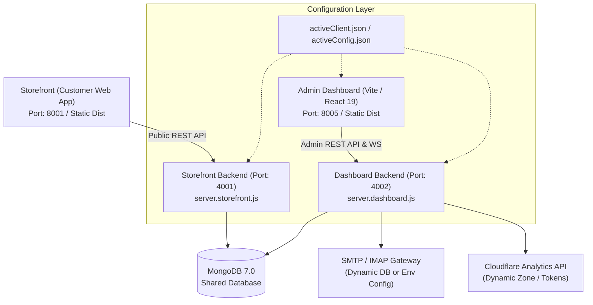

# White-Label Multi-Tenant E-Commerce Platform — Onboarding & Architecture Guide

Welcome to the **White-Label E-Commerce Platform** template codebase. This repository is engineered as an enterprise-grade, multi-tenant solution with zero hardcoded client credentials or brand names. All brand identities, domain routing, API endpoints, feature toggles, and business policies load dynamically at runtime from tenant configurations and environment variables.

---

## 🏗️ 1. System Architecture Overview

The codebase is organized into modular services designed for horizontal scalability, high throughput, and strict security isolation:



### 🔹 Dual-Backend Instance Architecture
To ensure maximum reliability and prevent resource contention between customer shopping traffic and heavy administrative operations, the backend is split into two specialized runtime instances:

1. **Storefront Public API** (`src/server.storefront.js` — Default Port: `4001`)
   - Handles public catalog browsing, product search, cart operations, customer OTP authentication, and checkout.
   - Optimized for fast response times, aggressive in-memory caching, and high concurrent read traffic.
   - Does not load admin-only routes or heavy analytical modules.

2. **Dashboard Business API** (`src/server.dashboard.js` — Default Port: `4002`)
   - Handles administrative operations: order processing, inventory updates, media uploads, AI studio transformations, customer CRM, staff role management, financial reporting, and system settings.
   - Houses real-time WebSocket servers (`/ws`) for live order push notifications.
   - Executes background schedulers (e.g. IMAP Webmail syncing, orphan asset cleanup, automated stock checks).

3. **Shared Core Layer** (`backend/src/common/`)
   - Unified Mongoose schemas and models (`ProductModel`, `OrderModel`, `UserModel`, `MemberModel`, `CategoryModel`, etc.).
   - Common configuration resolvers, cryptography, JWT verification, and database connection pools.

---

## ⚙️ 2. Tenant Configuration System

Every tenant is configured through a structured JSON file located in `configs/<tenantKey>.json`. The platform falls back gracefully to the default demo brand (`Flexivia` / `plexivia.online`) when no client config is specified.

### 📋 Configuration Structure (`configs/client.template.json`)

```json
{
  "clientKey": "yourbrand",
  "brandName": "Your Brand Name",
  "legalName": "Your Brand Legal Entity Ltd.",
  "tagline": "Your Brand Catchphrase",
  "domain": "yourbrand.com",
  "storefrontUrl": "https://yourbrand.com",
  "dashboardUrl": "https://admin.yourbrand.com",
  "apiBaseUrl": "https://api.yourbrand.com",
  "storefrontApiUrl": "https://api.yourbrand.com",
  "serviceApiBaseUrl": "https://service.yourbrand.com",
  "hubApiUrl": "https://hub.plexivia.online",
  "logoUrl": "/uploads/assets/logo.webp",
  "siteIconUrl": "/uploads/assets/favicon.ico",
  "contact": {
    "phone": "+8801700000000",
    "email": "info@yourbrand.com",
    "supportEmail": "support@yourbrand.com",
    "address": "Your Office Address, City, Country"
  },
  "features": {
    "brand": true,
    "categories": true,
    "attributes": true,
    "coupons": true,
    "reviews": true,
    "twoFactorAuth": true,
    "webmail": true,
    "aiStudio": true,
    "cloudflareAnalytics": true
  },
  "policies": {
    "allowBackorders": false,
    "lowStockThreshold": 5,
    "freeDeliveryThreshold": 2000,
    "defaultShippingChargeInside": 70,
    "defaultShippingChargeOutside": 130,
    "codEnabled": true,
    "onlinePaymentEnabled": true
  },
  "cloudFlareAnalytics": {
    "zoneId": "",
    "apiToken": "",
    "accountTag": "",
    "siteTag": ""
  }
}
```

---

## 🚀 3. Step-by-Step Client Onboarding Guide

Follow these steps to provision and deploy a new client onto the platform:

### Step 1: Create the Tenant Configuration File
1. Make a copy of the template configuration:
   ```bash
   cp configs/client.template.json configs/mybrand.json
   ```
2. Populate `configs/mybrand.json` with the new client's domain names, contact details, features, and policy parameters.

### Step 2: Configure Environment Variables
Create a `.env` file (or mount `/opt/<client>/configs/backend.env`) with the following required variables:

```ini
# Server & Port Configuration
PORT=4002
APP_ROLE=dashboard
NODE_ENV=production

# Database Configuration
MONGO_URI=mongodb://127.0.0.1:27017/mybrand-db

# JWT & Authentication Secrets
JWT_SECRET=your_super_secret_jwt_key_here
REFRESH_TOKEN_SECRET=your_super_secret_refresh_key_here
COOKIE_SECRET=your_super_secret_cookie_key_here

# Active Tenant Identifier
CLIENT_NAME=mybrand

# Initial Owner / Admin Account Setup
INITIAL_OWNER_NAME="Store Owner"
INITIAL_OWNER_EMAIL="owner@mybrand.com"
INITIAL_OWNER_PASSWORD="SecureGeneratedPassword123!"

# SMTP Fallback Configuration (Optional: Can also be configured via Dashboard UI)
SMTP_HOST=smtp.mailgun.org
SMTP_PORT=465
SMTP_SECURE=true
SMTP_USER=support@mybrand.com
SMTP_PASS=YourSmtpSecretPassword
SMTP_FROM_NAME="My Brand Support"
SMTP_FROM_EMAIL="support@mybrand.com"
```

### Step 3: Initialize Brand Assets
Place the client's visual assets into the public uploads directory (`/app/uploads/assets/` or `/var/www/uploads/assets/`):
- `logo.webp`: Primary transparent brand logo.
- `favicon.ico`: Browser tab icon.
- `og_banner.webp`: Social share OpenGraph card image.

### Step 4: Run Initial Admin Account Creation
On first boot, the platform checks for existing staff users. If none exist, you can execute the user initialization utility or allow auto-seeding from `INITIAL_OWNER_EMAIL`:
```bash
cd backend
node -e "require('./src/common/config/db')().then(() => console.log('Database connected successfully'));"
```

### Step 5: Build and Launch Containers
Using Docker Compose:
```bash
# Build and run containers
CLIENT=mybrand docker compose -f docker-compose.prod.yml up -d --build
```

Or using Makefile helper:
```bash
make deploy CLIENT=mybrand
```

### Step 6: Verify Endpoint Health
Verify that all services are operational:
- **Storefront API Health Check**: `curl -I https://api.mybrand.com/api/v1/system/health`
- **Dashboard API Health Check**: `curl -I https://service.mybrand.com/api/v1/system/health`
- **Admin Dashboard UI**: Open `https://admin.mybrand.com` in your browser.

---

## 📧 4. Transactional Emails & Tenant Repositories

- **Client Email Template Customization**: Transactional email templates (order confirmations, invoices, status update notifications, OTPs) are maintained dynamically by each tenant within their dedicated storefront/backend repository or database configurations.
- **Dynamic Variable Injection**: Email deliveries inject `brandName`, `supportEmail`, `phone`, `address`, and `logoUrl` dynamically from the active tenant config.
- **Dynamic Webmail & IMAP Syncing**: Inboxes can be managed directly within the Admin Dashboard under **Settings > SMTP / IMAP Settings**, allowing clients to connect custom mailbox servers with symmetric at-rest encryption.

---

## 🔒 5. Security & Isolation Standard

- **Zero Hardcoded Secrets**: Never commit real API keys, Meta Pixel tokens, Cloudflare Zone IDs, VPS IP addresses, or personal developer credentials into this repository.
- **Generic Fallback Only**: The only permitted fallback brand identity is **`Flexivia`** (`plexivia.online`).
- **Dynamic Pathing**: Never hardcode local absolute paths in production code. All paths must derive from environment variables or standard project roots.
- **Tenant Isolation**: Each production tenant operates in isolated Docker networks with dedicated MongoDB databases.
