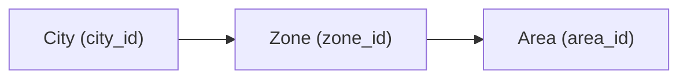
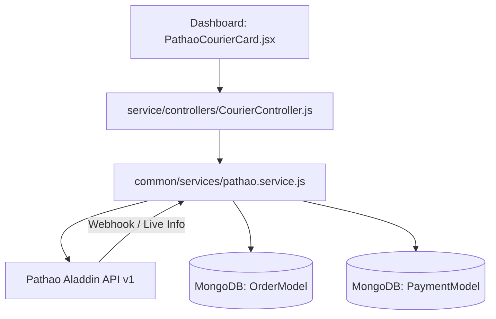

# Pathao Courier Merchant API (Aladdin API v1)
## Complete Technical Specification & Integration Reference

This document provides a comprehensive, production-grade technical specification of the **Pathao Courier Merchant API** (`aladdin/api/v1`). It covers authentication, store management, geo-hierarchy, pricing calculation, order creation, bulk dispatch, live tracking, and architectural integration with **Surokkha.store**.

---

## Table of Contents
1. [Overview & Environments](#1-overview--environments)
2. [Authentication & Token Management](#2-authentication--token-management)
   - [2.1 Issue Token (Password Grant)](#21-issue-access-token-password-grant)
   - [2.2 Refresh Token (Refresh Grant)](#22-issue-access-token-from-refresh-token)
3. [Merchant Store Management](#3-merchant-store-management)
   - [3.1 List Stores](#31-get-merchant-store-list)
   - [3.2 Create Store](#32-create-a-new-store)
4. [Coverage & Geographic Locations](#4-coverage--geographic-locations)
   - [4.1 City List](#41-get-list-of-cities)
   - [4.2 Zone List (by City)](#42-get-zones-within-a-city)
   - [4.3 Area List (by Zone)](#43-get-areas-within-a-zone)
5. [Price Calculation & Financial Estimation](#5-price-calculation--financial-estimation)
   - [5.1 Price Plan API](#51-calculate-price-plan)
   - [5.2 Financial Formula & Fee Structure](#52-financial-formula--fee-structure)
6. [Order Consignments & Dispatch](#6-order-consignments--dispatch)
   - [6.1 Create Single Order Consignment](#61-create-a-new-order)
   - [6.2 Create Bulk Orders](#62-create-bulk-orders)
7. [Tracking & Status Reconciliation](#7-tracking--status-reconciliation)
   - [7.1 Order Short Info / Live Tracking](#71-get-order-short-info)
   - [7.2 Status Lifecycle & Transition Matrix](#72-status-lifecycle--transition-matrix)
8. [Surokkha.store Implementation Mapping](#8-demostore-implementation-mapping)

---

## 1. Overview & Environments

Pathao Courier operates on the **Aladdin API v1** architecture. All authorized endpoints require a Bearer token in the `Authorization` header.

### 1.1 Base URLs

| Environment | Base URL | Purpose |
| :--- | :--- | :--- |
| **Sandbox (Testing)** | `https://courier-api-sandbox.pathao.com` | Development, sandbox merchant accounts, and testing |
| **Production (Live)** | `https://api-hermes.pathao.com` | Live order processing and production consignments |

### 1.2 Common HTTP Headers

```http
Content-Type: application/json
Accept: application/json
Authorization: Bearer <ISSUED_ACCESS_TOKEN>
```

> [!IMPORTANT]
> - Tokens are valid for **432,000 seconds** (exactly 5 days).
> - Pathao rejects phone numbers that do not match the **11-digit Bangladeshi standard** (`01XXXXXXXXX`). Always sanitize phone numbers before sending requests.

---

## 2. Authentication & Token Management

### 2.1 Issue Access Token (Password Grant)
Generates an initial access token and refresh token using merchant credentials.

- **Endpoint:** `POST /aladdin/api/v1/issue-token`
- **Authentication:** None (Public)

#### Request Headers
```http
Content-Type: application/json
Accept: application/json
```

#### Request Body
```json
{
  "client_id": "{{client_id}}",
  "client_secret": "{{client_secret}}",
  "grant_type": "password",
  "username": "{{your_email}}",
  "password": "{{your_password}}"
}
```

#### Parameter Dictionary
| Field | Type | Required | Description |
| :--- | :--- | :---: | :--- |
| `client_id` | `string` | **Yes** | Client ID obtained from Pathao Developer Dashboard |
| `client_secret` | `string` | **Yes** | Client Secret obtained from Pathao Developer Dashboard |
| `grant_type` | `string` | **Yes** | Must strictly be `"password"` |
| `username` | `string` | **Yes** | Merchant login email address |
| `password` | `string` | **Yes** | Merchant account password |

#### Success Response (`200 OK`)
```json
{
  "token_type": "Bearer",
  "expires_in": 432000,
  "access_token": "eyJ0eXAiOiJKV1QiLCJhbGciOiJSUzI1NiJ9...",
  "refresh_token": "def502005a8b79d2b274296ce311a3..."
}
```

#### Response Fields
| Field | Type | Description |
| :--- | :--- | :--- |
| `token_type` | `string` | Always `"Bearer"` |
| `expires_in` | `integer` | Token lifespan in seconds (default `432000` = 5 days) |
| `access_token` | `string` | Bearer token required for all subsequent API requests |
| `refresh_token` | `string` | Token used to renew expired access tokens |

---

### 2.2 Issue Access Token from Refresh Token
Generates a new access token without re-sending username and password credentials.

- **Endpoint:** `POST /aladdin/api/v1/issue-token`
- **Authentication:** None

#### Request Body
```json
{
  "client_id": "{{your_client_id}}",
  "client_secret": "{{client_secret}}",
  "grant_type": "refresh_token",
  "refresh_token": "ISSUED_REFRESH_TOKEN"
}
```

#### Parameter Dictionary
| Field | Type | Required | Description |
| :--- | :--- | :---: | :--- |
| `client_id` | `string` | **Yes** | Merchant Client ID |
| `client_secret` | `string` | **Yes** | Merchant Client Secret |
| `grant_type` | `string` | **Yes** | Must strictly be `"refresh_token"` |
| `refresh_token` | `string` | **Yes** | Previously received valid refresh token |

#### Success Response (`200 OK`)
```json
{
  "token_type": "Bearer",
  "expires_in": 432000,
  "access_token": "NEW_ACCESS_TOKEN",
  "refresh_token": "NEW_OR_REUSED_REFRESH_TOKEN"
}
```

---

## 3. Merchant Store Management

Pickup stores dictate where the Pathao rider will collect parcels from.

### 3.1 Get Merchant Store List
Fetches all configured stores associated with the merchant account.

- **Endpoint:** `GET /aladdin/api/v1/stores`
- **Authentication:** Bearer Token

#### Example cURL
```bash
curl --location 'https://api-hermes.pathao.com/aladdin/api/v1/stores' \
  --header 'Content-Type: application/json; charset=UTF-8' \
  --header 'Authorization: Bearer {{access_token}}'
```

#### Success Response (`200 OK`)
```json
{
  "message": "Store list fetched.",
  "type": "success",
  "code": 200,
  "data": {
    "data": [
      {
        "store_id": 381917,
        "store_name": "Surokkha Main Hub",
        "store_address": "House 123, Road 4, Sector 10, Uttara, Dhaka-1230, Bangladesh",
        "is_active": 1,
        "city_id": 1,
        "zone_id": 1070,
        "hub_id": 12,
        "is_default_store": true,
        "is_default_return_store": true
      }
    ],
    "total": 1,
    "current_page": 1,
    "per_page": 1000,
    "total_in_page": 1,
    "last_page": 1
  }
}
```

#### Store Attributes
| Field | Type | Description |
| :--- | :--- | :--- |
| `store_id` | `integer` | Unique ID of the store (passed when creating orders) |
| `store_name` | `string` | Store display name |
| `store_address` | `string` | Full physical address for package pickup |
| `is_active` | `integer` | `1` if active, `0` if inactive/disabled |
| `city_id` | `integer` | City identifier of pickup store |
| `zone_id` | `integer` | Zone identifier of pickup store |
| `is_default_store` | `boolean/int` | Primary pickup origin |
| `is_default_return_store` | `boolean/int` | Destination origin when parcels are returned |

---

### 3.2 Create a New Store
Registers a new warehouse or branch location for parcel pickup.

- **Endpoint:** `POST /aladdin/api/v1/stores`
- **Authentication:** Bearer Token

#### Request Body
```json
{
  "name": "Demo Store",
  "contact_name": "Test Merchant",
  "contact_number": "017XXXXXXXX",
  "secondary_contact": "015XXXXXXXX",
  "otp_number": "017XXXXXXXX",
  "address": "House 123, Road 4, Sector 10, Uttara, Dhaka-1230, Bangladesh",
  "city_id": 1,
  "zone_id": 1070,
  "area_id": 37
}
```

#### Parameter Dictionary
| Field | Type | Required | Constraints | Description |
| :--- | :--- | :---: | :--- | :--- |
| `name` | `string` | **Yes** | 3 to 50 chars | Store name |
| `contact_name` | `string` | **Yes** | 3 to 50 chars | Store representative name |
| `contact_number` | `string` | **Yes** | 11 chars | Store phone number (`01XXXXXXXXX`) |
| `secondary_contact` | `string` | No | 11 chars | Alternate phone number |
| `otp_number` | `string` | No | 11 chars | Phone number for dispatch OTPs |
| `address` | `string` | **Yes** | 15 to 120 chars | Store location description |
| `city_id` | `integer` | **Yes** | Valid ID | City identifier |
| `zone_id` | `integer` | **Yes** | Valid ID | Zone identifier |
| `area_id` | `integer` | **Yes** | Valid ID | Area identifier |

#### Success Response (`200 OK`)
```json
{
  "message": "Store created successfully, Please wait one hour for approval.",
  "type": "success",
  "code": 200,
  "data": {
    "store_name": "Demo Store"
  }
}
```

---

## 4. Coverage & Geographic Locations

Pathao organizes Bangladesh into a 3-tier geographical hierarchy:
$$\text{Country} \longrightarrow \text{City} \longrightarrow \text{Zone} \longrightarrow \text{Area}$$



### 4.1 Get List of Cities
- **Endpoint:** `GET /aladdin/api/v1/city-list`
- **Fallback Endpoint:** `GET /aladdin/api/v1/countries/1/city-list`
- **Authentication:** Bearer Token

#### Success Response (`200 OK`)
```json
{
  "message": "City successfully fetched.",
  "type": "success",
  "code": 200,
  "data": {
    "data": [
      { "city_id": 1, "city_name": "Dhaka" },
      { "city_id": 2, "city_name": "Chittagong" },
      { "city_id": 4, "city_name": "Rajshahi" },
      { "city_id": 6, "city_name": "Feni" }
    ]
  }
}
```

---

### 4.2 Get Zones within a City
- **Endpoint:** `GET /aladdin/api/v1/cities/{city_id}/zone-list`
- **Authentication:** Bearer Token

#### Parameter Dictionary
| Param | Type | Required | Description |
| :--- | :--- | :---: | :--- |
| `city_id` | `integer` | **Yes** | City identifier (Path param) |

#### Success Response (`200 OK`)
```json
{
  "message": "Zone list fetched.",
  "type": "success",
  "code": 200,
  "data": {
    "data": [
      { "zone_id": 298, "zone_name": "60 feet" },
      { "zone_id": 1070, "zone_name": "Abdullahpur Uttara" },
      { "zone_id": 1066, "zone_name": "Abul Hotel" }
    ]
  }
}
```

---

### 4.3 Get Areas within a Zone
- **Endpoint:** `GET /aladdin/api/v1/zones/{zone_id}/area-list`
- **Authentication:** Bearer Token

#### Parameter Dictionary
| Param | Type | Required | Description |
| :--- | :--- | :---: | :--- |
| `zone_id` | `integer` | **Yes** | Zone identifier (Path param) |

#### Success Response (`200 OK`)
```json
{
  "message": "Area list fetched.",
  "type": "success",
  "code": 200,
  "data": {
    "data": [
      {
        "area_id": 37,
        "area_name": "Bonolota",
        "home_delivery_available": true,
        "pickup_available": true
      },
      {
        "area_id": 3,
        "area_name": "Road 03",
        "home_delivery_available": true,
        "pickup_available": true
      }
    ]
  }
}
```

---

## 5. Price Calculation & Financial Estimation

### 5.1 Calculate Price Plan
Allows real-time cost estimation prior to dispatching an order.

- **Endpoint:** `POST /aladdin/api/v1/merchant/price-plan`
- **Authentication:** Bearer Token

#### Request Body
```json
{
  "store_id": 381917,
  "item_type": 2,
  "delivery_type": 48,
  "item_weight": 0.5,
  "recipient_city": 1,
  "recipient_zone": 1070
}
```

#### Parameter Dictionary
| Field | Type | Required | Description |
| :--- | :--- | :---: | :--- |
| `store_id` | `integer` | **Yes** | Pickup store identifier |
| `item_type` | `integer` | **Yes** | `1` for Document, `2` for Parcel |
| `delivery_type` | `integer` | **Yes** | `48` for Normal Delivery, `12` for On-Demand |
| `item_weight` | `float` | **Yes** | Package weight in kg (Min `0.5`, Max `10.0`) |
| `recipient_city` | `integer` | **Yes** | Destination City ID |
| `recipient_zone` | `integer` | **Yes** | Destination Zone ID |

#### Success Response (`200 OK`)
```json
{
  "message": "price",
  "type": "success",
  "code": 200,
  "data": {
    "price": 80,
    "discount": 0,
    "promo_discount": 0,
    "plan_id": 69,
    "cod_enabled": 1,
    "cod_percentage": 0.01,
    "additional_charge": 0,
    "final_price": 80
  }
}
```

---

### 5.2 Financial Formula & Fee Structure

From the response attributes:
- **Base Delivery Price:** `final_price` (e.g., ৳80.00)
- **COD Percentage:** `cod_percentage` (typically `0.01` = 1%)

#### Settlement & Deduction Formula

$$\text{COD Fee} = \text{Amount to Collect} \times \text{cod\_percentage}$$

$$\text{Total Deductions} = \text{Delivery Fee} + \text{COD Fee} + \text{Additional / VAT}$$

$$\text{Net Merchant Disbursement} = \text{Amount to Collect} - \text{Total Deductions}$$

#### Example Calculation (Order of ৳2,000.00)
- $\text{Amount to Collect} = ৳2,000.00$
- $\text{Delivery Fee} = ৳80.00$
- $\text{COD Fee} = ৳2,000.00 \times 0.01 = ৳20.00$
- $\text{Net Received by Merchant} = ৳2,000.00 - (৳80.00 + ৳20.00) = ৳1,900.00$

---

## 6. Order Consignments & Dispatch

### 6.1 Create a New Order
Creates a delivery consignment with Pathao and generates a unique tracking code.

- **Endpoint:** `POST /aladdin/api/v1/orders`
- **Authentication:** Bearer Token

#### Request Body
```json
{
  "store_id": 381917,
  "merchant_order_id": "SSH2610007-8492",
  "recipient_name": "Sumon Ahmed",
  "recipient_phone": "01601671653",
  "recipient_secondary_phone": "01700000000",
  "recipient_address": "House 123, Road 4, Sector 10, Uttara, Dhaka-1230",
  "recipient_city": 1,
  "recipient_zone": 1070,
  "recipient_area": 37,
  "delivery_type": 48,
  "item_type": 2,
  "special_instruction": "Call before delivery",
  "item_quantity": 1,
  "item_weight": "0.5",
  "item_description": "Gift Combo 4",
  "amount_to_collect": 900
}
```

#### Parameter Dictionary
| Field | Type | Required | Range / Validation | Description |
| :--- | :--- | :---: | :--- | :--- |
| `store_id` | `integer` | **Yes** | Valid Store ID | Pickup location |
| `merchant_order_id` | `string` | No | Max 100 chars | Your internal Order Number (e.g. `SSH2610007`) |
| `recipient_name` | `string` | **Yes** | 3 to 100 chars | Customer full name |
| `recipient_phone` | `string` | **Yes** | Exactly 11 digits | Receiver phone (`01XXXXXXXXX`) |
| `recipient_secondary_phone` | `string` | No | Exactly 11 digits | Secondary contact phone |
| `recipient_address` | `string` | **Yes** | 10 to 220 chars | Full delivery street address |
| `recipient_city` | `integer` | No | Valid City ID | Optional (Auto-detected from address if omitted) |
| `recipient_zone` | `integer` | No | Valid Zone ID | Optional (Auto-detected if omitted) |
| `recipient_area` | `integer` | No | Valid Area ID | Optional (Auto-detected if omitted) |
| `delivery_type` | `integer` | **Yes** | `48` or `12` | `48`: Normal, `12`: On Demand |
| `item_type` | `integer` | **Yes** | `1` or `2` | `1`: Document, `2`: Parcel |
| `special_instruction` | `string` | No | Max 255 chars | Delivery rider notes |
| `item_quantity` | `integer` | **Yes** | $\ge 1$ | Total quantity of parcels |
| `item_weight` | `float` | **Yes** | 0.5 to 10.0 kg | Parcel weight |
| `item_description` | `string` | No | Text | Brief contents description |
| `amount_to_collect` | `integer` | **Yes** | $\ge 0$ | COD amount (set `0` if prepaid) |

#### Success Response (`200 OK`)
```json
{
  "message": "Order Created Successfully",
  "type": "success",
  "code": 200,
  "data": {
    "consignment_id": "PT12345678",
    "merchant_order_id": "SSH2610007-8492",
    "order_status": "Pending",
    "delivery_fee": 80
  }
}
```

---

### 6.2 Create Bulk Orders
Submits an array of orders in a single asynchronous batch request.

- **Endpoint:** `POST /aladdin/api/v1/orders/bulk`
- **Authentication:** Bearer Token

#### Request Body
```json
{
  "orders": [
    {
      "store_id": 381917,
      "merchant_order_id": "SSH2610008",
      "recipient_name": "Demo Recipient One",
      "recipient_phone": "01711111111",
      "recipient_address": "House 123, Road 4, Sector 10, Uttara, Dhaka",
      "delivery_type": 48,
      "item_type": 2,
      "special_instruction": "Fragile items",
      "item_quantity": 1,
      "item_weight": "0.5",
      "amount_to_collect": 1000,
      "item_description": "Care Package"
    },
    {
      "store_id": 381917,
      "merchant_order_id": "SSH2610009",
      "recipient_name": "Demo Recipient Two",
      "recipient_phone": "01822222222",
      "recipient_address": "House 3, Road 14, Dhanmondi, Dhaka",
      "delivery_type": 48,
      "item_type": 2,
      "special_instruction": "Deliver before 5 PM",
      "item_quantity": 2,
      "item_weight": "1.0",
      "amount_to_collect": 2500,
      "item_description": "Apparel set"
    }
  ]
}
```

#### Success Response (`202 Accepted`)
```json
{
  "message": "Your bulk order creation request is accepted,<br> please wait some time to complete order creation.",
  "type": "success",
  "code": 202,
  "data": true
}
```

---

## 7. Tracking & Status Reconciliation

### 7.1 Get Order Short Info
Retrieves the current shipment status using the Pathao Consignment ID.

- **Endpoint:** `GET /aladdin/api/v1/orders/{consignment_id}/info`
- **Authentication:** Bearer Token

#### Example cURL
```bash
curl --location 'https://api-hermes.pathao.com/aladdin/api/v1/orders/PT12345678/info' \
  --header 'Authorization: Bearer {{access_token}}'
```

#### Success Response (`200 OK`)
```json
{
  "message": "Order info",
  "type": "success",
  "code": 200,
  "data": {
    "consignment_id": "PT12345678",
    "merchant_order_id": "SSH2610007-8492",
    "order_status": "Delivered",
    "order_status_slug": "Delivered",
    "updated_at": "2026-10-11 15:11:40",
    "invoice_id": "INV-992384"
  }
}
```

---

### 7.2 Status Lifecycle & Transition Matrix

Pathao consignment statuses map into internal **Surokkha.store** statuses as follows:

| Pathao Status | Pathao Slug | Surokkha Order Status | Payment Action | Reconciliation Impact |
| :--- | :--- | :--- | :--- | :--- |
| **Pending** | `pending` | `shipped` | `pending` | Consignment registered; awaiting pickup |
| **Pickup Requested** | `pickup_requested` | `shipped` | `pending` | Rider assigned for store pickup |
| **Picked / In-Transit** | `in_transit` | `shipped` | `pending` | Parcel at Pathao sorting hub |
| **Delivered** | `delivered` | `completed` | `paid` | **Gross collected; deduct COD & delivery fee** |
| **Delivery Failed** | `delivery_failed` | `shipped` | `pending` | Re-attempt scheduled |
| **Return in Transit**| `return_in_transit`| `shipped` | `pending` | Parcel returning to merchant |
| **Returned** | `returned` | `return` | `returned` | **Customer paid 0; record return fee expense** |

---

## 8. Surokkha.store Implementation Mapping

The following table summarizes how each Pathao endpoint is consumed by the **Surokkha.store** backend services:



| Pathao Endpoint | Surokkha Service Method | Surokkha Controller | API Route |
| :--- | :--- | :--- | :--- |
| `/issue-token` | `getValidPathaoToken()` | `testPathaoConnectionController` | `POST /api/v1/courier/pathao/test` |
| `/stores` (GET) | `getPathaoStores()` | `getStoresController` | `GET /api/v1/courier/pathao/stores` |
| `/stores` (POST) | `createPathaoStore()` | `createStoreController` | `POST /api/v1/courier/pathao/stores` |
| `/city-list` | `getPathaoCities()` | `getCitiesController` | `GET /api/v1/courier/pathao/cities` |
| `/cities/{id}/zone-list` | `getPathaoZones(cityId)` | `getZonesController` | `GET /api/v1/courier/pathao/zones/:cityId` |
| `/zones/{id}/area-list` | `getPathaoAreas(zoneId)` | `getAreasController` | `GET /api/v1/courier/pathao/areas/:zoneId` |
| `/merchant/price-plan` | `calculatePathaoPricePlan()` | `calculatePriceController` | `POST /api/v1/courier/pathao/price-plan` |
| `/orders` | `createPathaoOrder()` | `createOrderConsignmentController`| `POST /api/v1/courier/pathao/orders/create` |
| `/orders/bulk` | `createPathaoBulkOrders()` | `createBulkOrderConsignmentsController`| `POST /api/v1/courier/pathao/orders/bulk-create` |
| `/orders/{id}/info` | `getPathaoOrderInfo(id)` | `trackOrderController` | `GET /api/v1/courier/pathao/orders/:id/track` |

---
*Document Version: 1.0.0 — Generated for Surokkha.store Courier Integration.*
