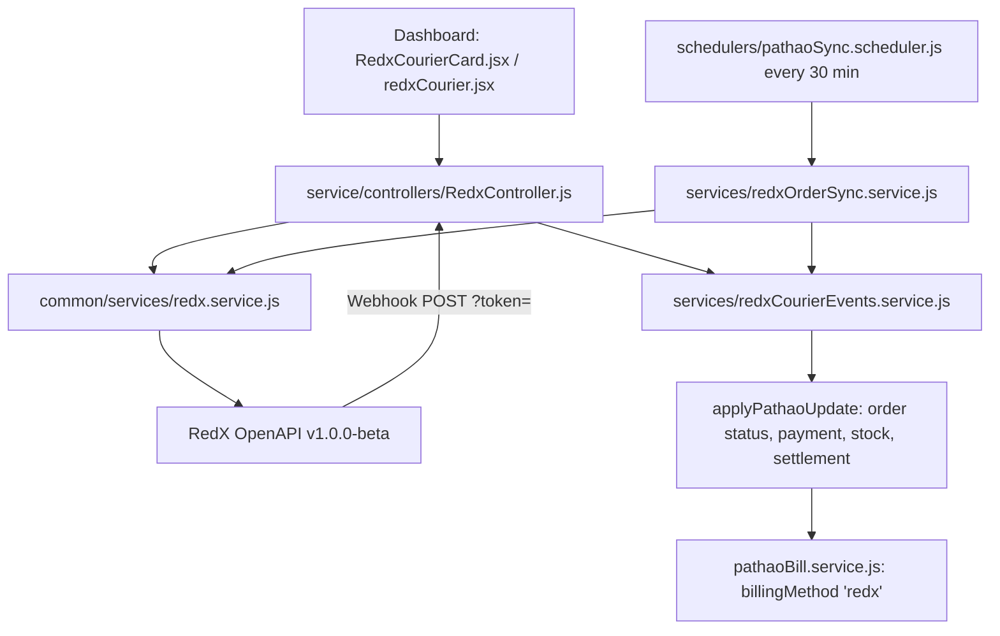

# RedX Courier OpenAPI (v1.0.0-beta)
## Complete Technical Specification & Integration Reference

This document specifies the **RedX OpenAPI** (`v1.0.0-beta`) as published at <https://redx.com.bd/developer-api/>, and how it is integrated into **Surokkha.store**. It covers authentication, areas, pickup stores, charge calculation, parcel creation and cancellation, tracking, the webhook, and the multi-courier controls (Settings → Couriers).

---

## Table of Contents
1. [Overview & Environments](#1-overview--environments)
2. [Authentication](#2-authentication)
3. [Coverage Areas](#3-coverage-areas)
4. [Pickup Store Management](#4-pickup-store-management)
5. [Charge Calculation](#5-charge-calculation)
6. [Parcels: Create, Update / Cancel](#6-parcels-create-update--cancel)
7. [Tracking & Parcel Info](#7-tracking--parcel-info)
8. [Webhook](#8-webhook)
9. [Status Lifecycle & Mapping](#9-status-lifecycle--mapping)
10. [Multi-courier Controls (Settings → Couriers)](#10-multi-courier-controls-settings--couriers)
11. [Surokkha.store Implementation Mapping](#11-surokkhastore-implementation-mapping)
12. [Setup Checklist](#12-setup-checklist)

---

## 1. Overview & Environments

| Environment | Base URL | Purpose |
| :--- | :--- | :--- |
| **Sandbox** | `https://sandbox.redx.com.bd/v1.0.0-beta` | Simulated operations; nothing reaches real parcels |
| **Production** | `https://openapi.redx.com.bd/v1.0.0-beta` | Live parcels |

Each environment has its **own token**. The environment is chosen in Settings → RedX Courier (`redxCourier.environment`) and the base URL is derived from it (`REDX_BASE_URLS` in `common/services/redx.service.js`).

---

## 2. Authentication

RedX uses one long-lived JWT per merchant and environment. It is issued in the RedX merchant panel → **Developer API** → **Request token**. There is **no** token issue or refresh endpoint, unlike Pathao's password grant.

```http
API-ACCESS-TOKEN: Bearer <jwt_token>
Content-Type: application/json
```

> [!IMPORTANT]
> - The header name is `API-ACCESS-TOKEN`, not `Authorization`.
> - The token is stored in `StoreSettings.redxCourier.accessToken`. The API only ever returns it masked (`abcd****wxyz`). An `.env` fallback `REDX_ACCESS_TOKEN` exists for bootstrap only.
> - Phone numbers are normalised to the 11-digit BD format (`01XXXXXXXXX`), the same rule used for Pathao.

The **Test connection** button calls `GET /pickup/stores` with the entered token and records `lastTestStatus` / `lastTestMessage`.

---

## 3. Coverage Areas

RedX uses a single flat list of areas. There is no city → zone → area hierarchy.

| Endpoint | Purpose |
| :--- | :--- |
| `GET /areas` | All delivery areas |
| `GET /areas?post_code=<code>` | Areas for one postal code |
| `GET /areas?district_name=<name>` | Areas for one district |

```json
{ "areas": [ { "id": 1, "name": "Mohammadpur(Dhaka)", "post_code": 1207, "division_name": "Dhaka", "zone_id": 1 } ] }
```

The dispatch dialog loads `/areas` once per page load and caches it. The operator then searches by area name or post code. A parcel needs **both** `delivery_area` (name) and `delivery_area_id`. The order stores them as `courier.deliveryAreaName` and `courier.recipientAreaId`.

---

## 4. Pickup Store Management

| Endpoint | Method | Body / Params |
| :--- | :--- | :--- |
| `/pickup/stores` | GET | List of `{ id, name, address, area_name, area_id, phone, created_at }` |
| `/pickup/store/info/<id>` | GET | One store (`pickup_store`) |
| `/pickup/store` | POST | `{ name, phone, address, area_id }` |

The Owner picks a default pickup store in Settings. On save, the backend fetches the store details and caches `pickupStoreName` and `pickupAreaId`. `pickupAreaId` is required by the charge calculator.

---

## 5. Charge Calculation

`GET /charge/charge_calculator?delivery_area_id=&pickup_area_id=&cash_collection_amount=&weight=`

- `weight` is in **grams**.
- Response: `{ "deliveryCharge": 60, "codCharge": 0 }`.

The charge is used in two places:
- The dispatch dialog shows a live estimate.
- On dispatch, `deliveryCharge` is saved as `courier.deliveryFee`. This creates the pending **RedX delivery charge** bill from the dispatch day.

When parcel info later reports `charge`, it is stored as `courier.actualDeliveryFee`. That value then overrides the estimate in the settlement and the bill.

---

## 6. Parcels: Create, Update / Cancel

### 6.1 Create Parcel — `POST /parcel`

| Field | Type | Required | Notes |
| :--- | :--- | :--- | :--- |
| `customer_name` | string | Yes | |
| `customer_phone` | string | Yes | 11-digit BD |
| `delivery_area` | string | Yes | Area **name** from `/areas` |
| `delivery_area_id` | integer | Yes | Area id from `/areas` |
| `customer_address` | string | Yes | |
| `cash_collection_amount` | string | Yes | COD amount (order total minus what is already paid) |
| `parcel_weight` | number | Yes | Grams (default from settings, 500) |
| `value` | number | Yes | Declared value (order total) |
| `merchant_invoice_id` | string | No | `<orderNumber>-<4 random digits>` |
| `instruction` | string | No | |
| `is_closed_box` | "true"/"false" | No | Closed box = customer cannot open before paying |
| `pickup_store_id` | number | No | Default pickup store from settings |
| `paid_return_charge` | number | No | Not used yet |
| `parcel_details_json` | array | No | Not used yet |

Response: `{ "tracking_id": "20A312THJDJ8" }`. The tracking id is saved as `courier.consignmentId`, with `courier.provider = "redx"`.

### 6.2 Update / Cancel — `PATCH /parcels`

```json
{
  "entity_type": "parcel-tracking-id",
  "entity_id": "<tracking_id>",
  "update_details": { "property_name": "status", "new_value": "cancelled", "reason": "..." }
}
```

Response: `{ "success": true, "message": "Request Accepted" }`. After a cancel, the order is updated with the `cancelled` status, and the RedX courier bill is deleted (`pickup_cancelled` slug).

---

## 7. Tracking & Parcel Info

| Endpoint | Returns |
| :--- | :--- |
| `GET /parcel/track/<tracking_id>` | `tracking[]` of `{ message_en, message_bn, time }` |
| `GET /parcel/info/<tracking_id>` | `parcel` with `status`, `charge`, `cash_collection_amount`, `delivery_type`, `pickup_location`, … |

**Sync Live Status** in the RedX card calls both endpoints and applies `parcel.status` to the order. The scheduled sync calls only `/parcel/info`.

---

## 8. Webhook

RedX POSTs status changes to a merchant **Callback URL**. Credentials must be passed as query parameters:

```
https://<dashboard-host>/api/v1/courier/redx/webhook?token=<redxCourier.webhookToken>
```

- The token is generated automatically on the first settings save (48 hex characters). It is compared in constant time, and a wrong token gets `401`.
- Copy the URL from Settings → RedX Courier → **Webhook & sync**, and paste it into RedX Developer API → Webhook → **Save Link**.

Payload:
```json
{
  "tracking_number": "<REDX_TRACKING_ID>",
  "timestamp": "<TIMESTAMP>",
  "status": "<STATUS>",
  "message_en": "...",
  "message_bn": "...",
  "invoice_number": "<INVOICE_NUMBER>",
  "delivery_type": "regular | reverse | exchange-delivery | exchange-return | partial-delivery | partial-return"
}
```

`lastWebhookAt` is updated on every valid call. Unknown tracking numbers are acknowledged with `200` and ignored.

---

## 9. Status Lifecycle & Mapping

RedX statuses are translated to the shared courier slugs used by `applyPathaoUpdate()` (`service/services/pathaoCourierEvents.service.js`). As a result, order status, payment, stock, settlement and the courier bill follow **exactly the same rules as Pathao**.

| RedX status | Meaning | Shared slug | Effect on order |
| :--- | :--- | :--- | :--- |
| `pickup-pending` | Created, waiting pickup | `pickup_pending` | stays `shipped` |
| `ready-for-delivery` | Received from merchant | `ready_for_delivery` | `shipped` |
| `delivery-in-progress` | With rider | `delivery_in_progress` | `shipped` |
| `delivered` | Delivered | `delivered` | → `completed` (money still with RedX) |
| `delivered` + `delivery_type: partial-delivery` | Partial | `partial_delivery` | → `completed`, partial category |
| `agent-hold` | On hold | `on_hold` | category `on_hold` |
| `agent-returning` | Return in progress | `return_in_transit` | → `return` |
| `returned` | Returned | `returned` | → `return` |
| `agent-area-change` | Area change | `agent_area_change` | `shipped` |
| `paid` | RedX paid the merchant | `paid` | settlement `invoiced`, payment received in full, bill marked paid |
| `cancelled` | Cancelled | `pickup_cancelled` | courier bill deleted |

Mapping code: `service/services/redxCourierEvents.service.js` (`redxSlugFor`, `redxLabelFor`, `applyRedxUpdate`).

---

## 10. Multi-courier Controls (Settings → Couriers)

- `StoreSettings.enabledCouriers` (default `["pathao"]`) is the list of couriers the **Owner** has switched on (`PUT /api/v1/courier/providers`, Owner only).
- Couriers appear in the list only if they are registered in `backend/src/common/config/couriers.js`, which means they have a backend service. Today that is `pathao` and `redx`.
- **Disabling a courier only blocks NEW dispatches.** `POST /courier/redx/parcels` returns `403 COURIER_DISABLED`, and the "Send with RedX" option disappears. Tracking, manual sync, the 30-minute scheduled sync, the webhook, cancellation and the bills of parcels already sent all keep working.
- Dashboard: `CourierDispatchButton` shows the dispatched courier's button. Otherwise it shows one "Send with X" button if one courier is active, or a **Send with courier ▾** dropdown if several are active. `CourierDetailsCard` (order details page) shows the card of the courier the order was dispatched with.

---

## 11. Surokkha.store Implementation Mapping



| RedX Endpoint | Service Method | Controller | API Route | Roles |
| :--- | :--- | :--- | :--- | :--- |
| — | `getRedxConfig()` | `getRedxSettingsController` | `GET /api/v1/courier/redx/config` | Operators |
| — | — | `updateRedxSettingsController` | `PUT /api/v1/courier/redx/config` | Owner |
| `/pickup/stores` | `testRedxConnection()` | `testRedxConnectionController` | `POST /api/v1/courier/redx/test` | Owner |
| `/areas` | `getRedxAreas()` | `getRedxAreasController` | `GET /api/v1/courier/redx/areas?post_code=&district_name=` | Operators |
| `/pickup/stores` | `getRedxPickupStores()` | `getRedxPickupStoresController` | `GET /api/v1/courier/redx/pickup-stores` | Operators |
| `/pickup/store` | `createRedxPickupStore()` | `createRedxPickupStoreController` | `POST /api/v1/courier/redx/pickup-stores` | Owner |
| `/charge/charge_calculator` | `calculateRedxCharge()` | `calculateRedxChargeController` | `POST /api/v1/courier/redx/charge` | Operators |
| `/parcel` | `createRedxParcel()` | `createRedxParcelController` | `POST /api/v1/courier/redx/parcels` (**needs RedX enabled**) | Operators |
| `/parcel/info`, `/parcel/track` | `getRedxParcelInfo()`, `trackRedxParcel()` | `trackRedxParcelController` | `GET /api/v1/courier/redx/parcels/:trackingId/track` | Operators |
| `/parcels` (PATCH) | `cancelRedxParcel()` | `cancelRedxParcelController` | `POST /api/v1/courier/redx/parcels/:trackingId/cancel` | Owner, Admin |
| `/parcel/info` (loop) | `syncRedxOrders()` | `syncRedxOrdersController` | `POST /api/v1/courier/redx/orders/sync` | Operators |
| webhook | — | `redxWebhookController` | `POST /api/v1/courier/redx/webhook?token=` | Public (token) |

**Data model**
- `StoreSettings.redxCourier`: `environment`, `accessToken`, `pickupStoreId`, `pickupStoreName`, `pickupAreaId`, `defaultParcelWeight` (g), `isClosedBox`, `webhookToken`, `lastWebhookAt`, `lastTest*`, `lastOrderSync*`.
- `Order.courier`: `provider: "redx"`, `consignmentId` / `trackingCode` = RedX tracking id, `merchantOrderId` = `merchant_invoice_id`, `recipientAreaId`, `deliveryAreaName`, `deliveryFee` (estimate), `actualDeliveryFee` (`parcel.charge`), `amountToCollect`, `itemWeight` (kg), `history[]`.
- Bills: one auto bill per parcel with `billingMethod: "redx"` and title "RedX delivery charge – Order #…". Pathao bills keep `billingMethod: "pathao"`, so the Pathao bills page is not affected.

**Isolation from Pathao.** The Pathao sync, parcels list and parcel summary now filter on `courier.provider ∈ {pathao, null}`. Because of this, RedX parcels are never polled against Pathao and never listed on the Pathao pages.

---

## 12. Setup Checklist

1. In the RedX merchant panel → **Developer API**, click **Request token** for Production (and Sandbox if needed).
2. Dashboard → Settings → **RedX Courier**: choose the environment, paste the token, click **Test connection**, pick a **pickup store**, set the default weight and the closed-box default, then **Save**.
3. Copy the **Callback URL** from the Webhook & sync card. Paste it into RedX Developer API → Webhook → **Save Link**.
4. Dashboard → Settings → **Couriers** (Owner): switch **RedX** on and Save.
5. Open an order and use **Send with courier ▾** → RedX (or **Send with RedX** if RedX is the only active courier).

---
*Document Version: 1.0.0 — RedX Courier Integration for Surokkha.store.*
